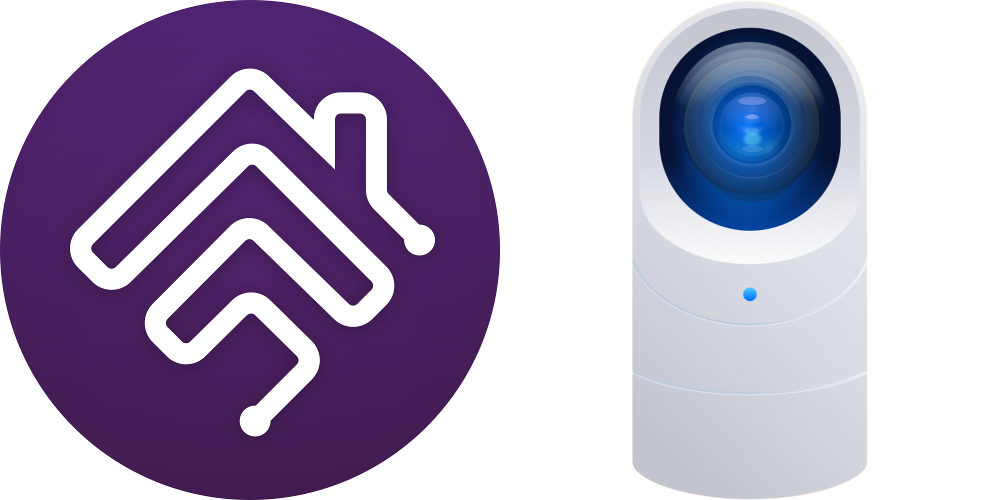

<!-- MASTHEAD:BEGIN - Auto-generated by homebridge-plugin-utils. Do not edit this region by hand. -->
<SPAN ALIGN="CENTER" STYLE="text-align:center">
<DIV ALIGN="CENTER" STYLE="text-align:center">

[](https://github.com/hjdhjd/homebridge-unifi-protect)

# Homebridge UniFi Protect

[](https://www.npmjs.com/package/homebridge-unifi-protect)
[](https://www.npmjs.com/package/homebridge-unifi-protect)
[](https://discord.gg/QXqfHEW)
[](https://github.com/homebridge/homebridge/wiki/Verified-Plugins)

## Complete HomeKit support for the UniFi Protect ecosystem using [Homebridge](https://homebridge.io).
</DIV>
</SPAN>
<!-- MASTHEAD:END -->

`homebridge-unifi-protect` is a [Homebridge](https://homebridge.io) plugin that provides HomeKit support to the [UniFi Protect](https://ui.com/camera-security) device ecosystem. [UniFi Protect](https://ui.com/camera-security) is [Ubiquiti's](https://www.ui.com) video security platform, with rich camera, doorbell, and NVR controller hardware options for you to choose from, as well as an app which you can use to view, configure and manage your video camera and doorbells.

### Configuration Reference

You shouldn't need this for day-to-day use...the defaults suit almost everyone, and the right place to configure HBUP is the webUI, where every option is validated for you. Hand-editing the JSON in your Homebridge `config.json` is error-prone and easy to get subtly wrong. This page is here for when you come across a setting and want to know exactly what it does.

There isn't much left in `config.json`, and that's by design. It holds the plugin's identity, the connection details for each of your Protect controllers, and the list of feature options you've set. Everything you can actually tailor is a [feature option](https://github.com/hjdhjd/homebridge-unifi-protect/blob/main/docs/FeatureOptions.md), and the webUI is where you set those.

```js
"platforms": [
  {
    "platform": "UniFi Protect",
    "name": "UniFi Protect",

    "options": [
      "Enable.Motion.Switch"
    ],

    "controllers": [
      {
        "address": "1.2.3.4",
        "username": "some-homebridge-user (or create a new one just for homebridge)",
        "password": "some-password"
      }
    ]
  }
]
```

The settings come in two groups: platform-level fields that apply to the whole plugin, and controller-level fields inside each entry of the `controllers` array. The `Level` column below tells you which is which.

| Field            | Level      | Description                                             | Default                          | Required |
|------------------|------------|---------------------------------------------------------|----------------------------------|----------|
| platform         | Platform   | Must always be `UniFi Protect`.                         | UniFi Protect                    | Yes      |
| name             | Platform   | An optional name for the plugin instance, shown in the Homebridge logs. | UniFi Protect    | No       |
| controllers      | Platform   | The list of UniFi Protect controllers to connect to. Each entry takes the controller-level fields below. |  | Yes      |
| options          | Platform   | The [feature options](https://github.com/hjdhjd/homebridge-unifi-protect/blob/main/docs/FeatureOptions.md) you've set. The webUI writes this list for you...that reference is the authority on every option available to you and what each one does. | [] | No |
| address          | Controller | Host or IP address of your UniFi Protect controller.    |                                  | Yes      |
| username         | Controller | The username of the local UniFi Protect account you use with HBUP. |                       | Yes      |
| password         | Controller | The password of that local UniFi Protect account.       |                                  | Yes      |
| verifyTls        | Controller | Require this controller to present a TLS certificate that verifies, on every connection the plugin makes to it, livestreams and two-way audio included. Streams read directly over RTSP aren't verified. Leave this off for a controller presenting the self-signed certificates it ships with. | false                            | No       |

### Where Your Older Settings Went

If you've been using HBUP for a while, your `config.json` may still carry a few settings this page doesn't list. Most of them simply have a new home.

The doorbell ring delay, verbose FFmpeg logging, the FFmpeg path, the MQTT broker URL, and the MQTT topic are all feature options now, as is the livestreaming address override. You don't need to do anything about them. The first time you open the plugin's settings page, HBUP moves each one into its matching feature option and clears the old property out of your configuration. The three per-controller settings among them...the MQTT broker URL, the MQTT topic, and the address override...need to reach the controller before HBUP knows where to file them, so if one of your controllers is offline at that moment, its settings stay put and HBUP tries again the next time you open the page. Until a setting moves, the plugin goes on reading the old property, so nothing changes underneath you in the meantime. The [feature options reference](https://github.com/hjdhjd/homebridge-unifi-protect/blob/main/docs/FeatureOptions.md) is the authority on what each one is now called and what it defaults to.

Two settings didn't move anywhere. They're retired, because in each case there's a better single place for that information to live:

  * **A controller's name.** HBUP uses the name your controller carries in the UniFi console. Set it there once and the plugin follows it, so there's no second name to keep in step.
  * **Doorbell message presets.** Doorbell messages are defined in the UniFi Protect app, and HBUP surfaces the messages saved there as message switches on your doorbell in HomeKit. The [doorbell documentation](https://github.com/hjdhjd/homebridge-unifi-protect/blob/main/docs/Doorbell.md#doorbell-messages) covers how that works.

### Managing Your Controllers

You don't need to hand-edit `config.json` to add a controller or change one. It's all in the plugin's **Settings** tab in the webUI:

  * **Adding a controller.** Use the **Add Controller** button at the top of the sidebar, just above the controller list. The login is checked against the controller before anything is saved.
  * **Editing a controller.** Select the controller in the sidebar and open **Controller connection settings**, which sits just beneath its details. That's where you change its address, username, password, or TLS certificate verification.
  * **Removing a controller.** Same place...the editor offers removal alongside saving.

A controller HBUP can't reach gets the same editor, on the connection error its page shows instead of the usual details. That's deliberate: a controller you can't connect to is exactly the one you most need to correct or remove, whether the password changed, the address moved, or the console is simply switched off.

When you remove a controller, HBUP can also delete the feature options you'd set for that controller and its devices, but only when it knows what those devices are. If the controller answered with its device list during this webUI session, the removal offers you that cleanup as a choice. If it didn't...because it's unreachable, or because you haven't visited it in this session...those feature options are left in place. You can tidy them up by hand, or connect to the controller successfully and remove it again.

---

## Documentation
<!-- DOCUMENTATION:BEGIN - Auto-generated by homebridge-plugin-utils. Do not edit this region by hand. -->
* Getting Started
  * [Installation](https://github.com/hjdhjd/homebridge-unifi-protect/blob/main/README.md#installation): installing this plugin, including system requirements.
  * [Plugin Configuration](https://github.com/hjdhjd/homebridge-unifi-protect/blob/main/README.md#getting-started): how to quickly get up and running.
  * [Best Practices](https://github.com/hjdhjd/homebridge-unifi-protect/blob/main/docs/BestPractices.md): best practices for getting the most of your HomeKit setup and UniFi Protect.
  * [Troubleshooting](https://github.com/hjdhjd/homebridge-unifi-protect/blob/main/docs/Troubleshooting.md): running into login problems or streaming issues? Give this a read before looking anywhere else.
  * [Changelog](https://github.com/hjdhjd/homebridge-unifi-protect/blob/main/docs/Changelog.md): changes and release history of this plugin, starting with v3.0.

* Additional Topics
  * [Feature Options](https://github.com/hjdhjd/homebridge-unifi-protect/blob/main/docs/FeatureOptions.md): granular options to allow you to set the camera quality individually, show or hide specific cameras, controllers, and more.
  * [Autoconfiguration](https://github.com/hjdhjd/homebridge-unifi-protect/blob/main/docs/Autoconfiguration.md): how HBUP sources and selects your video (the timeshift buffer, stream selection, transcoding, and transmuxing), autoconfigures your controller, and why.
  * [Audio Options](https://github.com/hjdhjd/homebridge-unifi-protect/blob/main/docs/AudioOptions.md): options to further tailor how audio is handled from Protect, such as background noise reduction.
  * [Doorbells](https://github.com/hjdhjd/homebridge-unifi-protect/blob/main/docs/Doorbell.md): how UniFi Protect doorbell support works in this plugin, and how to use all the available features including doorbell messages.
  * [HomeKit Secure Video](https://github.com/hjdhjd/homebridge-unifi-protect/blob/main/docs/HomeKitSecureVideo.md): how HomeKit Secure Video support works in this plugin with UniFi Protect.
  * [Liveview Scenes](https://github.com/hjdhjd/homebridge-unifi-protect/blob/main/docs/Liveviews.md): use the UniFi Protect liveviews feature (available in the UniFi Protect controller webUI) to create motion-detection scenes.
  * [Viewports](https://github.com/hjdhjd/homebridge-unifi-protect/blob/main/docs/Viewports.md): control what a UniFi Protect Viewport displays on screen, right from HomeKit.
  * [MQTT](https://github.com/hjdhjd/homebridge-unifi-protect/blob/main/docs/MQTT.md): how to configure MQTT support.
<!-- DOCUMENTATION:END -->
